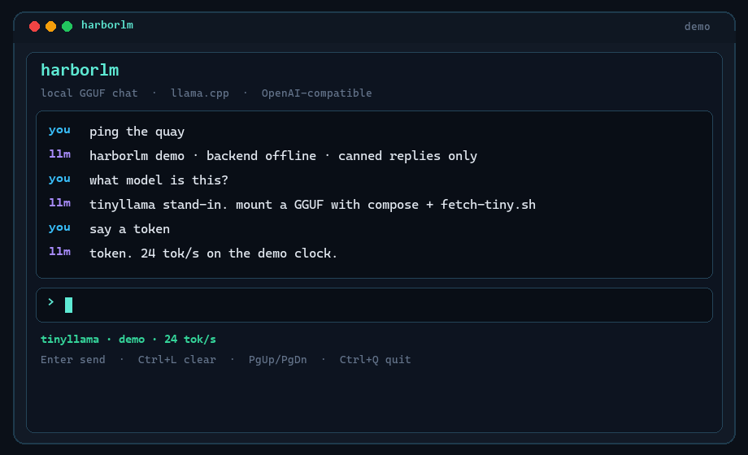

# harborlm

Local GGUF chat on Linux. llama.cpp server + TUI. Docker Compose.



Python 3.11 client talks OpenAI-compatible `POST /v1/chat/completions` to a `llama.cpp` server. Weights stay on disk; this repo does not vendor a GGUF.

## interface

History pane, one prompt line, one status bar.

```
┌ harborlm ───────────────────────────────── demo ─┐
│ you  ping the quay                               │
│ llm  harborlm demo · backend offline · canned    │
│      replies only                                │
│ you  what model is this?                         │
│ llm  tinyllama stand-in. mount a GGUF with       │
│      compose + fetch-tiny.sh                     │
│ you  say a token                                 │
│ llm  token. 24 tok/s on the demo clock.          │
├──────────────────────────────────────────────────┤
│ >                                                │
├──────────────────────────────────────────────────┤
│ tinyllama · demo · 24 tok/s                      │
│ Enter send · Ctrl+L clear · PgUp/PgDn · Ctrl+Q   │
└──────────────────────────────────────────────────┘
```

| key | action |
|---|---|
| **Enter** | send |
| **Ctrl+L** | clear history |
| **PgUp / PgDn** | scroll history |
| **Esc** | clear the input line |
| **Ctrl+Q** / **Ctrl+C** | quit |

Status: `model · url-or-demo · prompt+completion tok · tok/s`. Demo is offline (canned replies). Live streams SSE when the server sends it, else one-shot JSON. Bad SSE lines are skipped. Connect errors retry once.

```
python -m harborlm chat --url http://127.0.0.1:8080/v1 --model tinyllama
python -m harborlm chat --demo
python -m harborlm chat --demo --session ./chat.jsonl
python -m harborlm chat --demo --once "ping the quay" --json
python -m harborlm ping --url http://127.0.0.1:8080/v1
python -m harborlm ping --url http://127.0.0.1:8080/v1 --json
```

| flag | where | meaning |
|---|---|---|
| `--demo` | chat | canned replies, no sockets |
| `--url` | chat, ping | OpenAI base (default `http://127.0.0.1:8080/v1`) |
| `--model` | chat | llama.cpp alias (default `tinyllama`) |
| `--once TEXT` | chat | one turn, print, exit |
| `--json` | chat `--once`, ping | machine JSON on stdout |
| `--session PATH` | chat | append/load jsonl transcript |
| `--timeout SEC` | chat, ping | per-call timeout (`> 0`) |
| `--connect-timeout SEC` | chat | TCP connect timeout |
| `--no-stream` | chat | one-shot JSON completions |

## session

`--demo` transcript (no network):

```
you  ping the quay
llm  harborlm demo · backend offline · canned replies only

you  what model is this?
llm  tinyllama stand-in. mount a GGUF with compose + fetch-tiny.sh

you  say a token
llm  token. 24 tok/s on the demo clock.

tinyllama · demo · 3+9 tok · 24 tok/s
```

Same three turns as `screenshots/ui.png`. One-shot print without a TTY:

```
python -m harborlm chat --demo --once "ping the quay"
```

## environment

```
scripts/fetch-tiny.sh
        │  wget/curl ~482 MiB Q2_K GGUF
        ▼
 models/tiny.gguf     (gitignored, not in this repo)
        │  compose volume  ../models → /models:ro
        ▼
 compose/docker-compose.yml   service llm
        │  ghcr.io/ggerganov/llama.cpp:server
        │  -m /models/tiny.gguf --host 0.0.0.0 --port 8080 --alias tinyllama
        ▼
 :8080 /v1/models  /v1/chat/completions
        │
        ▼
 python -m harborlm chat --url http://127.0.0.1:8080/v1 --model tinyllama
```

`fetch-tiny.sh` pulls [TheBloke TinyLlama 1.1B Chat Q2_K GGUF](https://huggingface.co/TheBloke/TinyLlama-1.1B-Chat-v1.0-GGUF) into `models/tiny.gguf`. Q4_0 URL is commented in the script.

Windows (Docker Desktop, PowerShell, repo root) — fetch then compose:

```
curl.exe -L --fail -o models\tiny.gguf https://huggingface.co/TheBloke/TinyLlama-1.1B-Chat-v1.0-GGUF/resolve/main/tinyllama-1.1b-chat-v1.0.Q2_K.gguf
docker compose -f compose/docker-compose.yml up
```

Optional TUI container: `docker compose -f compose/docker-compose.yml --profile tui up --build`.

## build

Offline first (no Docker, no GGUF):

```
python -m pip install -r requirements.txt
python -m pytest
python -m harborlm chat --demo
python scripts/render_ui.py
```

Live server after `models/tiny.gguf` exists:

```
docker compose -f compose/docker-compose.yml up
python -m harborlm ping --url http://127.0.0.1:8080/v1
python -m harborlm chat --url http://127.0.0.1:8080/v1 --model tinyllama
```
